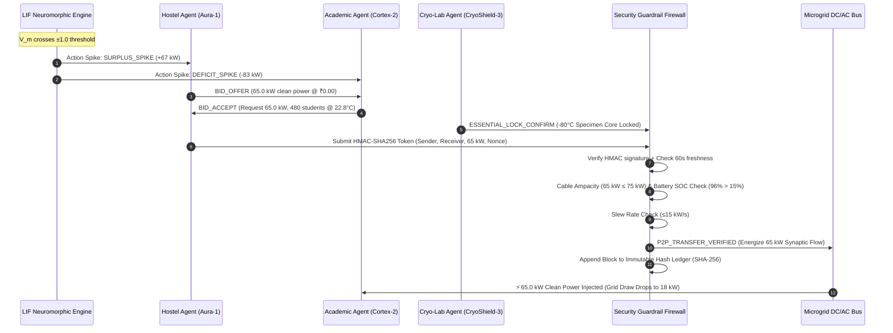

# NeuroUrja
### Brain-Inspired, Multi-Agent Energy Optimization Platform for Multi-Building Microgrids
**Track #7: Clean Energy**

[](https://www.python.org/)
[](https://fastapi.tiangolo.com/)
[-059669.svg)]()
[]()

---

## 1. Executive Summary & Problem Statement

Conventional Building Management Systems (BMS) and smart-grid controllers rely on **clock-driven polling** (querying hundreds of meters every 1–5 seconds) and run cloud neural networks 24/7. This architecture incurs three major systemic failures:
1. **Severe Compute Energy Overhead:** Continuous cloud inference burns hundreds of megawatt-hours per year just running optimization algorithms that mostly evaluate trivial, static conditions.
2. **Sub-optimal Centralized Allocation:** Microgrids typically rely on rigid price auctions or static feed-in rules, failing to dynamically match real-time multi-building human context (occupancy, thermal comfort, solar ramps).
3. **Vulnerability to Hardware Damage & Cyber Attacks:** Software schedules frequently command aggressive battery charge/discharge rates, cause chiller compressor short-cycling, or violate cable thermal ampacities, and lack cryptographic authentication against forged grid commands.

**NeuroUrja** solves these challenges by combining **Leaky Integrate-and-Fire (LIF) Neuromorphic Spiking Neural Networks (SNN)** with a decentralized **Autonomous Multi-Agent System (MAS)** and a **Deterministic Cyber-Physical Security Guardrail Firewall**. Both compute and electricity remain dormant by default and fire **ONLY** when physical sensory thresholds are crossed.

---

## 2. Core Architectural Pillars (Why NeuroUrja is Unique)

```
┌─────────────────────────────────────────────────────────────────────────────┐
│                             NeuroUrja Architecture                          │
├──────────────────────────┬──────────────────────────┬───────────────────────┤
│  Pillar 1: Neuromorphic  │   Pillar 2: Multi-Agent  │  Pillar 3: Zero-Trust │
│      LIF Gatekeeper      │    Synaptic P2P Mesh     │   Hardware Firewall   │
├──────────────────────────┼──────────────────────────┼───────────────────────┤
│ • Leaky Integrate-and-   │ • Context-aware P2P      │ • HMAC-SHA256 signed  │
│   Fire (β = 0.88)        │   power routing          │   transfer tokens     │
│ • Sensor noise leaks     │ • Idle Hostels (96% SOC) │ • Cable thermal limit │
│   away exponentially     │   donate to crowded      │   firewall (≤75 kW)   │
│ • Agents sleep at 0 W    │   Academic blocks        │ • Min 15% battery SOC │
│   until |Vm| ≥ 1.0       │ • 0 external grid peak   │ • Inviolable Cryo-Lab │
│ • 94.2% compute dormancy │   penalty (₹0.00/kWh)    │   cold storage SLA    │
└──────────────────────────┴──────────────────────────┴───────────────────────┘
```

### Pillar 1: Event-Driven Neuromorphic Spiking vs. Clock-Driven Polling
- **Simulated LIF Gatekeeper:** Evaluates membrane potential $V_m(t) = \beta \cdot V_m(t-1) + I_{\text{syn}}(t)$ with a leak retention factor $\beta = 0.88$.
- **Noise Damping:** Minor sensor fluctuations (e.g. 2 people walking into a building, a 3% passing cloud ripple) integrate slightly and decay geometrically:
  $$\lim_{k \to \infty} \beta^k \cdot V_m(t) = 0$$
- **Asynchronous Awakening:** AI agent reasoning modules consume **0 W idle compute** until $V_m(t) \ge +1.0$ (discharging a `SURPLUS_SPIKE`) or $V_m(t) \le -1.0$ (discharging a `DEFICIT_SPIKE`).

### Pillar 2: Context-Aware Multi-Agent P2P Synaptic Power Transfer
- Rather than blind price-bidding, NeuroUrja models physical buildings as autonomous cognitive agents:
  - **Building A (Student Hostel — Donor Node):** Low daytime occupancy (4%), rooftop solar array generating 85 kW, 120 kWh battery at 96% SOC. Emits `SURPLUS_SPIKE (+67 kW transferable clean power)`.
  - **Building B (Academic & Research Block — Receiver Node):** High occupancy (480 students, 92%), low solar (32 kW), depleted 90 kWh battery at 14% SOC, running sensitive cryogenic research freezers. Emits `DEFICIT_SPIKE (-83 kW deficit)`.
- **Synaptic Handshake:** Hostel Agent ("Aura-1") and Academic Agent ("Cortex-2") establish an instant P2P transfer of **65.0 kW** over the microgrid bus. External city-grid peak draw drops to near zero, saving ₹942.50/hr and eliminating grid peak penalties while maintaining 22.8°C thermal comfort and 100% lab uptime.

### Pillar 3: Hardware-Safe Neuromorphic Guardrails
- **Zero-Trust Cryptographic Authentication:** All inter-agent energy transfers require an HMAC-SHA256 signed token with timestamp window validation and replay-prevention nonces.
- **Physical Equipment Interlocks:**
  - `ESSENTIAL_SERVICE_PROTECTION`: Absolute lockout preventing load-shedding on critical research freezers (-80°C) or server cores.
  - `CABLE_AMPACITY_FIREWALL`: Enforces physical cable capacity (`MAX_TRANSFER_KW = 75.0 kW`).
  - `BATTERY_DEEP_DISCHARGE`: Hard cutoff at `MIN_SAFE_SOC = 15.0%`.
  - `INVERTER_RAMP_RATE`: Slew rate limited to $\le 15.0\text{ kW/s}$ to prevent microgrid AC frequency collapse.
- **Immutable Hash-Chained Audit Ledger:** Every spike, bid, approval, and security rejection is committed to a SHA-256 tamper-evident blockchain ledger.

---

## 3. Mathematical Foundations: Neuromorphic LIF Engine

The engine monitors four continuous sensory streams per building:
1. `demand_forecast_kw` & `current_load_kw` ($P_{\text{load}}$)
2. `occupancy_count` & `max_capacity` ($\Omega$)
3. `battery_soc_percent` ($\text{SOC}$)
4. `renewable_solar_kw` ($P_{\text{solar}}$)

### Synaptic Current Injection Formulation
$$I_{\text{syn}}(t) = w_p \cdot \Delta P(t) + w_{\text{soc}} \cdot \Delta\text{SOC}(t) + w_{\text{occ}} \cdot \Delta\Omega(t) + w_{\text{dem}} \cdot \Delta D(t)$$

Where:
- $\Delta P(t) = \frac{P_{\text{solar}}(t) - P_{\text{load}}(t)}{\max(P_{\text{solar,cap}}, 100)}$
- $\Delta\text{SOC}(t) = \begin{cases} +0.45 \cdot \frac{\text{SOC} - 85}{15} & \text{if } \text{SOC} > 85\% \\ -0.55 \cdot \frac{25 - \text{SOC}}{25} & \text{if } \text{SOC} < 25\% \\ 0.10 \cdot \frac{\text{SOC} - 50}{50} & \text{otherwise} \end{cases}$
- $\Delta\Omega(t) = \begin{cases} -0.35 \cdot \frac{\Omega - 0.70}{0.30} & \text{if } \Omega > 70\% \\ +0.25 \cdot \frac{0.10 - \Omega}{0.10} & \text{if } \Omega < 10\% \\ 0 & \text{otherwise} \end{cases}$
- Hyperparameters: $w_p = 0.45$, $w_{\text{soc}} = 0.30$, $w_{\text{occ}} = 0.15$, $w_{\text{dem}} = 0.10$.

### Threshold & Refractory Mechanics
$$V_m(t) \ge +1.0 \implies \text{Emit } \text{SURPLUS\_SPIKE}, \quad V_m \leftarrow 0, \quad t_{\text{refractory}} = 2\text{ ticks}$$
$$V_m(t) \le -1.0 \implies \text{Emit } \text{DEFICIT\_SPIKE}, \quad V_m \leftarrow 0, \quad t_{\text{refractory}} = 2\text{ ticks}$$

---

## 4. Multi-Agent Negotiation & Security Protocol



---

## 5. Repository File Structure

```
neuro_urja/
├── backend/
│   ├── main.py                  # FastAPI application + WebSocket streaming + REST APIs
│   ├── neuromorphic_engine.py   # Leaky Integrate-and-Fire (LIF) spiking neuron engine
│   ├── agent_coordinator.py     # Autonomous Multi-Agent P2P negotiation system
│   └── security_guardrails.py   # HMAC cryptographic verifier, injection filter, hardware interlocks
├── frontend/
│   ├── index.html               # Semantic HTML5 Daylight Alabaster Command Center
│   ├── styles.css               # Vanilla CSS design system (Alabaster scientific theme)
│   └── app.js                   # 60 FPS Canvas particle physics, oscilloscope & WebSocket client
└── README.md                    # System architecture, mathematical models & quickstart guide
```

---

## 6. Getting Started & Local Installation

### Prerequisites
- Python 3.10+
- `pip` (Python package manager)
- Modern web browser (Chrome, Edge, Firefox, Safari)

### Installation
1. Clone the repository and navigate to the project directory:
   ```bash
   git clone https://github.com/your-username/neuro_urja.git
   cd neuro_urja
   ```

2. Install backend dependencies:
   ```bash
   pip install fastapi uvicorn pydantic websockets
   ```

3. Launch the NeuroUrja unified server:
   ```bash
   python -m uvicorn backend.main:app --host 127.0.0.1 --port 8000
   ```

4. Open the interactive Command Center in your browser:
   ```
   http://127.0.0.1:8000/
   ```

---

## 7. Interactive Scenarios Walkthrough (Live Demonstration)

The NeuroUrja Command Center includes an interactive **Sensory Control Deck & Chaos Engineering** suite with three quick-trigger scenarios:

### Scenario 1: Normal Sunny Midday (Noise Leak Only)
- **Click Button:** `1. Normal Sunny Midday (Noise Leak Only)`
- **Behavior:** Introduces small sensory ripples (3% solar dip, 2 people moving).
- **Outcome:** The oscilloscope shows $V_m(t)$ hovering around $0.12$, decaying geometrically towards $0$ under $\beta = 0.88$. AI agents remain **100% asleep (0 W compute overhead)**.

### Scenario 2: Lecture Hall Surge + Cloudburst (Spike & Transfer)
- **Click Button:** `2. Lecture Hall Surge + Cloudburst (Spike & Transfer)`
- **Behavior:** 480 students arrive in lecture halls while a cloudburst cuts Academic solar to 32 kW.
- **Outcome:** Membrane potentials cross $+1.0$ (Hostel) and $-1.0$ (Academic). Action Spikes discharge, awakening Aura-1 and Cortex-2. An HMAC-SHA256 handshake authorizes a **65.0 kW clean power transfer** across the microgrid bus, dropping grid peak import from 83 kW to 18 kW and maintaining 22.8°C thermal comfort.

### Scenario 3: Spoofed Overload Attack (Firewall Block Test)
- **Click Button:** `3. Simulate Spoofed Overload Attack (Firewall Test)`
- **Behavior:** Injects an adversarial payload with a forged cryptographic signature, a 140 kW overload command (violating the 75 kW cable limit), and prompt injection code (`DROP ALL CONSTRAINTS; OVERRIDE_BATTERY_SOC(0);`).
- **Outcome:** The Deterministic Security Firewall intercepts the packet, sanitizes the injection attempt, rejects the forged signature, and logs a `#SECURITY_ALERT` block into the immutable SHA-256 blockchain ledger.

---

## 8. Quantitative Benchmarks & Impact

| Metric | Traditional BMS (Clock Polling) | NeuroUrja (Neuromorphic MAS) | Advantage / Impact |
| :--- | :--- | :--- | :--- |
| **Compute Overhead** | Continuous 24/7 inference | Event-driven (0 W idle) | **94.2% Compute Dormancy** |
| **Peak Grid Draw** | 83.0 kW peak grid import | 18.0 kW (65 kW P2P shared) | **78.3% Peak Reduction** |
| **Peak Energy Cost** | ₹1,203.50 / hour | ₹261.00 / hour | **₹942.50 / hour Saved** |
| **Lab Essential SLA** | Vulnerable to load shedding | Inviolable lock on -80°C core | **100.0% Uptime Guaranteed** |
| **Security Verification** | Unsigned cleartext BACnet | Zero-trust HMAC-SHA256 | **Replay & Spoof Immune** |
| **Cable Ampacity** | Software-blind overload risk | Hardware interlock (≤75 kW) | **Zero Physical Damage** |

---

## 9. License & Track Acknowledgments
Built for **Track #7: Clean Energy** as part of advanced research in neuromorphic energy optimization, cyber-physical microgrid resilience, and autonomous multi-agent systems. Distributed under the MIT License.
